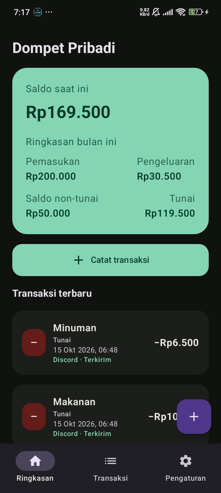

# PriWallet

Aplikasi Android Kotlin + Jetpack Compose untuk pencatatan keuangan lokal. Spesifikasi dan ruang lingkup yang disetujui ada di [SPECIFIKASI_MVP.md](SPECIFIKASI_MVP.md).

## Preview

  

  

Screenshot menampilkan tampilan aplikasi pada perangkat Android; nama layar pada screenshot diambil sebelum perubahan merek. Nama aplikasi pada instalasi baru adalah **PriWallet**.

## Menjalankan

Buka folder ini di Android Studio versi yang mendukung Android Gradle Plugin 8.9.2, pasang Android SDK Platform 35, lalu jalankan konfigurasi `app` pada emulator/perangkat Android (minimum API 26). Gradle akan mengunduh dependensi saat sinkronisasi.

## Cakupan implementasi saat ini

- Room sebagai sumber transaksi; IDR disimpan sebagai bilangan bulat.
- Ringkasan saldo non-tunai, tunai, dan total; transfer antar saldo melalui formulir Catat transaksi.
- Tambah/edit/hapus transaksi, kategori awal dan pengelolaan kategori.
- Filter daftar berdasarkan jenis, kategori, bulan berjalan, atau semua periode.
- Pilihan tema putih/hitam tersimpan di perangkat.
- URL webhook dienkripsi AES-GCM; kunci hanya berada di Android Keystore dan berkas backup aplikasi dinonaktifkan.
- Discord embed untuk pemasukan, pengeluaran, dan transfer; WorkManager menangani pengiriman tertunda dan retry.

Discord webhook merupakan rahasia. Siapa pun yang memilikinya dapat mengirim pesan ke channel terkait. Pesan pemasukan/pengeluaran menyertakan catatan opsional; transfer tidak menyertakan catatan. Untuk aplikasi yang didistribusikan luas, evaluasi backend agar URL webhook tidak berada di klien.
